<picture>
  <source media="(prefers-color-scheme: dark) and (max-width: 600px)" srcset="assets/intro-mobile-dark.svg">
  <source media="(max-width: 600px)" srcset="assets/intro-mobile-light.svg">
  <source media="(prefers-color-scheme: dark)" srcset="assets/intro-dark.svg">
  
</picture>

## Ayo, whatup y’all?

I’m **Keenly**, a software and data engineer in Washington, DC. I’m interested in making AI systems more **reliable, understandable, and useful** — and using engineering to work on problems that matter.

### Building & exploring

AI interpretability · probabilistic computing · alternatives to transformer architectures · visualization for STEM education

I’m always up for collaborating on tools that make complex ideas easier to see.

| A few projects | What’s inside |
| :--- | :--- |
| [DBUSE](https://github.com/keenlychuang/dbuse-proto) | Question answering across collections of PDF, Word, and Excel documents. |
| [Bookbridge](https://github.com/keenlychuang/bookbridge) | Turning booklists into Notion databases with language models. |
| [Diffusion text](https://github.com/keenlychuang/diff-grid-text) | A little experiment in finding words in digital noise. |

### Previously

- **MIT · Probabilistic Computing Project** — AI research during my MEng. [probcomp ↗](https://probcomp.csail.mit.edu/)
- **MIT–IBM Watson AI Lab** — trace visualization, data synthesis, and testing for Cora in DARPA’s Machine Common Sense challenge.
- **Memorial Sloan Kettering** — prototyping data processing and visualization tools for clinical, research, and education teams.

### Away from the keyboard

Usually running, lifting, reading, or finding another café to sit in. Marathon finisher; ongoing collector of book recommendations.

[On my bookshelf ↗](https://checker-ceramic-ddb.notion.site/Simon-s-Booklist-555d7d4891e24ed289aad3500b7447a3?pvs=4) &nbsp; · &nbsp; [Around the DMV ↗](https://checker-ceramic-ddb.notion.site/DMV-Coffee-Reviews-1036253e11ab80219f94d95ceaf57690?pvs=74)

---

[LinkedIn ↗](https://www.linkedin.com/in/keenly-chuang/) &nbsp; · &nbsp; [Say hello ↗](mailto:keenlyschuang@gmail.com)
